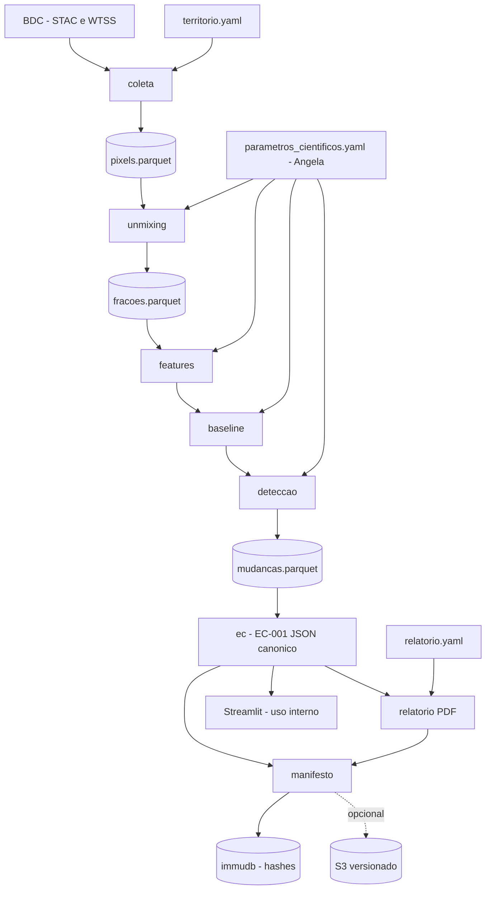

# Documento de design — Pipeline P0 do EC-001

## Visão geral

Pipeline local, em Docker, executado sob demanda por linha de comando. Cada etapa é uma função pura que lê artefatos de uma execução e grava novos artefatos. Ao final, um manifesto liga código, parâmetros, dados e resultados, e seus hashes são registrados no immudb. Decisões de origem: `docs/adr/001` a `010`.



## Módulos e responsabilidades

| Módulo | Entrada | Saída | Observações |
|---|---|---|---|
| `config` | YAML | Modelos pydantic validados | Falha rápida e mensagens por campo |
| `coleta` | Território, bandas, período | `pixels.parquet` + metadados de origem | STAC para janelas, WTSS para séries por coordenada; retry limitado |
| `unmixing` | `pixels.parquet`, endmembers | `fracoes.parquet` | Solver FCLS vetorizado; resíduo por pixel |
| `features` | `fracoes.parquet` | `features.parquet` | Índice e métricas definidos nos parâmetros |
| `baseline` | `features.parquet`, janela histórica | `baseline.parquet` | Estatísticas esperadas por pixel (e sazonalidade, se configurada) |
| `deteccao` | features, baseline, limiares | `mudancas.parquet` | Onde, quando, magnitude, trajetória, confiança |
| `ec` | Resultados + metadados | `ec-001.json` canônico | 19 seções; marca parâmetros provisórios/aprovados |
| `integridade` | Artefatos da execução | `manifest.json` + registro no immudb | Hash de conteúdo lógico; verificação |
| `relatorio` | EC + modelo | PDF/HTML | Jinja2 + WeasyPrint |
| `cli` | Subcomandos | — | `coletar`, `unmixing`, `features`, `baseline`, `deteccao`, `ec`, `registrar`, `relatorio`, `verificar` |

Interface típica de cada etapa (assinaturas ilustrativas):

```python
def run_unmixing(pixels_path: Path, params: ParametrosCientificos, out_dir: Path) -> Path: ...
def build_ec(run_dir: Path, params: ParametrosCientificos) -> Path: ...
def register_run(manifest_path: Path, client: ImmudbClient) -> RegistroIntegridade: ...
def verify_run(run_dir: Path, client: ImmudbClient) -> ResultadoVerificacao: ...
```

## Modelos de dados

### `pixels.parquet` (uma linha por pixel por data)

| Coluna | Tipo | Descrição |
|---|---|---|
| `pixel_id` | int64 | Identificador estável (derivado da grade da coleção: tile, linha, coluna) |
| `lon`, `lat` | float64 | Centro do pixel |
| `data` | date | Data da observação (ou do composto) |
| `b_<nome>` | float32 | Uma coluna por banda necessária, em reflectância |
| `q_nuvem`, `q_sombra`, `q_agua` | bool | Máscaras de qualidade |

Metadados do arquivo (key-value): coleção, versão, itens (ou hash da lista de itens), consulta (geometria, período, bandas), data/hora da consulta, fatores de escala.

### Tabelas derivadas

- `fracoes.parquet`: `pixel_id`, `data`, `f_<endmember>` (float32), `residuo` (float32), `valido` (bool).
- `features.parquet`: `pixel_id`, `data`, `<feature>` por feature definida.
- `baseline.parquet`: `pixel_id`, `<estatística>` por feature (média, desvio, e janela/sazonalidade conforme parâmetros), `n_obs`, `avaliavel` (bool).
- `mudancas.parquet`: `pixel_id`, `inicio`, `fim`, `magnitude`, `trajetoria`, `confianca`, `nivel`.

### Arquivos de configuração (exemplos com valores fictícios)

`configs/territorio/fazenda_piloto.yaml`

```yaml
nome: fazenda_piloto
geometria: configs/territorio/fazenda_piloto.geojson   # poligono da fazenda
periodo_analise: {inicio: 2024-01-01, fim: 2025-12-31}
```

`configs/parametros_cientificos/p0_provisorio.yaml`

```yaml
status: provisorio            # provisorio | aprovado
aprovado_por: null            # preenchido pela Angela ao aprovar
colecao: ALTERE_AQUI          # sensor/colecao do BDC, a confirmar
bandas: [b_vermelho, b_nir, b_swir1]
endmembers:                   # valores ficticios, apenas para teste
  vegetacao:  [0.03, 0.45, 0.20]
  solo:       [0.25, 0.30, 0.40]
  sombra:     [0.01, 0.02, 0.01]
baseline: {janela_inicio: 2019-01-01, janela_fim: 2023-12-31, min_obs: 20}
indice: {nome: indice_exemplo, definicao: "ver especificacao"}
limiares: {baixo: 0.10, medio: 0.25, alto: 0.40}     # ficticios
mascaras: {nuvem: true, sombra: true, agua: true}
```

`configs/relatorio/modelo_padrao.yaml`: título, seções, idioma, logotipo, texto de limitações.

### Evidence Card (`ec-001.json`)

Objeto JSON com as 19 seções do blueprint: `pergunta`, `hipotese`, `territorio`, `periodo`, `fontes_de_dados`, `metodo`, `features`, `baseline`, `deteccao_da_mudanca`, `localizacao`, `temporalidade`, `magnitude`, `trajetoria`, `incerteza`, `nivel_de_confianca`, `conclusao`, `evidencias_utilizadas`, `rastreabilidade`, `integridade`. Campos adicionais: `status_parametros` (provisório/aprovado), `versao_ec`, `limitacoes`.

Serialização canônica: chaves em ordem fixa, números arredondados à precisão declarada, UTF-8, sem espaços supérfluos. O hash SHA-256 do EC é calculado sobre essa forma.

### Manifesto (`manifest.json`)

```json
{
  "run_id": "...",
  "gerado_em": "...",
  "codigo": {"commit": "...", "dependencias_hash": "..."},
  "parametros": {"arquivo": "...", "sha256": "...", "status": "provisorio"},
  "entradas": [{"nome": "pixels.parquet", "sha256_conteudo": "...", "origem": {"colecao": "...", "itens_hash": "..."}}],
  "saidas":   [{"nome": "mudancas.parquet", "sha256_conteudo": "..."}],
  "ec": {"arquivo": "ec-001.json", "sha256": "..."},
  "relatorio": {"arquivo": "relatorio.pdf", "sha256": "..."}
}
```

## Integridade (immudb)

- Chaves: `run/<run_id>` → hash do manifesto; `ec/<ec_id>@<versao>` → hash do EC; `relatorio/<run_id>` → hash do relatório. Valores contêm apenas hashes e metadados mínimos.
- Gravação e leitura com as operações verificadas do SDK (confirmar a API na versão fixada); salvar o estado verificável junto da execução.
- Volume persistente em `data/immudb/`; backup periódico (S3, se usado).
- Extensão futura: carimbo do tempo externo sobre o hash do manifesto.

**Determinismo do hash de tabelas:** não hashear os bytes do Parquet (podem variar entre versões de bibliotecas); hashear o conteúdo lógico (colunas em ordem fixa, linhas ordenadas por chave, tipos fixos, floats arredondados à precisão declarada).

## Unmixing (resumo técnico)

- Modelo linear: `x ≈ E · f`, com `f ≥ 0` e `Σ f = 1`, onde `E` é a matriz bandas × endmembers.
- Abordagem de referência: FCLS por pixel (restrição de soma incorporada ao sistema aumentado e resolução por mínimos quadrados não negativos).
- Implementação: vetorizada/lote ou laço de NNLS acelerado com numba; **decisão a tomar por medição** de desempenho e validação contra `scipy.optimize.nnls`.
- Saída: frações, resíduo e indicador de validade por pixel.

## Tratamento de erros

- Configuração inválida: aborta antes de acessar dados externos, indicando o campo.
- Falha do BDC: retries limitados com espera crescente; sem resultado parcial marcado como completo.
- Pixel mascarado ou sem observações: marcado como inválido ou não avaliável, contado no resultado, nunca descartado em silêncio.
- Divergência na verificação: relatório de divergência por artefato; código de saída diferente de zero.

## Estratégia de testes

1. **Mistura sintética:** gera pixels com frações conhecidas (com e sem ruído) e confere a recuperação dentro de tolerância; compara com a implementação de referência.
2. **Golden de reprodutibilidade:** mini conjunto fixo → EC canônico → hash esperado; falha se o hash mudar sem mudança intencional.
3. **Validação de parâmetros:** casos válidos e inválidos (endmember incompleto, banda inexistente, limiares fora de ordem, status ausente).
4. Testes unitários por módulo (baseline, detecção, serialização canônica, manifesto, verificação com immudb em contêiner de teste).

## Execução e entrega contínua

- `Makefile`: `setup`, `lint`, `test`, `coletar`, `pipeline`, `registrar`, `relatorio`, `verificar`, `docker-build`.
- GitHub Actions: instalar com uv, rodar ruff e pytest a cada push.
- Imagem Docker com versões fixas; `docker compose` para o immudb local.
- Terraform (opcional): bucket S3 com versionamento, criptografia em repouso, bloqueio de acesso público e política mínima.

## Rastreabilidade com os requisitos e ADRs

| Requisito | Módulos | ADRs |
|---|---|---|
| 1 Configuração | `config` | 010 |
| 2–3 Coleta e armazenamento | `coleta` | 001, 002 |
| 4 Unmixing | `unmixing` | 004, 010 |
| 5–6 Features, baseline, detecção | `features`, `baseline`, `deteccao` | 010 |
| 7 EC | `ec` | 006, 010 |
| 8–9 Manifesto e integridade | `integridade` | 006 |
| 10 Relatório | `relatorio` | 007 |
| 11 Exploração interna | Streamlit | 007 |
| 12 Reprodutibilidade | Docker, testes golden | 003, 005, 008 |
| 13 Segurança e IP | repositório, S3 | 003, 008, 010 |
| 14 Qualidade e governança | CI, `docs/adr` | 008 |

## Riscos e pontos em aberto

- Sensor, bandas, índice e limiares dependem da Angela; até lá, parâmetros provisórios.
- Disponibilidade e desempenho do BDC podem variar; cachear localmente o que já foi coletado.
- Não determinismo numérico entre máquinas (BLAS, threads): fixar configuração e usar arredondamento declarado.
- Hash externo verificável por terceiros exige âncora externa (fora do P0).
- Confirmar termos de uso do BDC para finalidade comercial.
